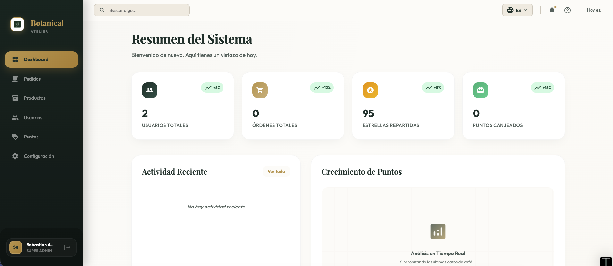
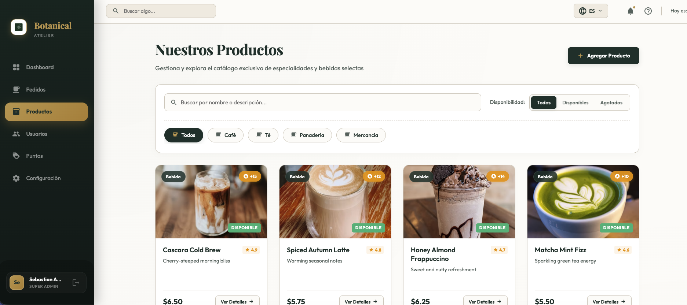

# Botanical Atelier - Admin Dashboard

Este es el panel de administración web para **Botanical Atelier**, un sistema de fidelización, puntos y gestión para una cafetería de especialidad y boutique de bebidas.

El proyecto está construido con **Angular** utilizando componentes modernos y reactivos.

---

## 📸 Capturas de Pantalla

### 1. Resumen del Sistema (Dashboard)
Aquí se visualizan las métricas clave como usuarios totales, órdenes realizadas, estrellas/puntos repartidos y puntos canjeados, así como la actividad reciente y gráficos de crecimiento en tiempo real.



### 2. Catálogo de Productos
Sección para explorar y gestionar la oferta de especialidades (Café, Té, Panadería, Mercancía), incluyendo precios, disponibilidad e incentivos de estrellas por producto.



---

## 🛠️ Tecnologías y Arquitectura

El frontend de la aplicación se ha desarrollado con las siguientes tecnologías:

- **Framework:** [Angular v21+](https://angular.dev/)
- **Gestor de Paquetes:** [Bun](https://bun.sh/)
- **Comunicación en Tiempo Real:** [Socket.IO Client](https://socket.io/) (para sincronización de actividad y eventos en vivo)
- **Gestión de Estado y Reactividad:** RxJS
- **Pruebas Unitarias:** [Vitest](https://vitest.dev/)

### Estructura del Proyecto

```tree
src/app/
├── core/         # Layouts, guards, interceptores y servicios globales
├── data/         # Servicios de datos, repositorios y modelos de API
├── features/     # Módulos y páginas funcionales de la aplicación
│   ├── auth/       # Pantallas de Login y recuperación
│   ├── dashboard/  # Panel principal con resúmenes y estadísticas
│   ├── orders/     # Control y flujo de pedidos
│   ├── points/     # Control de puntos/estrellas y canjes
│   ├── products/   # Catálogo y edición de productos
│   └── users/      # Gestión de clientes y administradores
└── shared/       # Componentes visuales y utilidades reutilizables
```

---

## 🚀 Inicio Rápido

### Requisitos Previos

Asegúrate de tener instalado [Bun](https://bun.sh/) o Node.js en tu sistema.

### Instalación de Dependencias

Instala los módulos necesarios ejecutando:

```bash
bun install
```

### Servidor de Desarrollo

Para iniciar el servidor de desarrollo local, ejecuta:

```bash
bun start
```

Una vez que el servidor esté corriendo, navega a `http://localhost:4200/`. La aplicación se recargará automáticamente al detectar cambios en los archivos fuente.

### Construcción para Producción

Para compilar y optimizar el proyecto para producción, ejecuta:

```bash
bun run build
```

Los archivos resultantes se almacenarán en el directorio `dist/`.

### Ejecutar Pruebas

Para correr las pruebas unitarias con Vitest:

```bash
bun test
```
