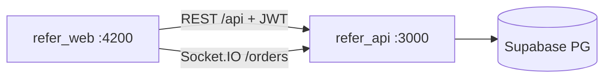

# Refer Web — Dashboard Admin Angular

Panel de administración web de [[Refer - Idea de Negocio|Refer]]. Solo `ADMIN` (el guard desloguea a no-admin). Consume [[API - Backend Go + Supabase|Refer API]] vía REST + Socket.IO. Sin SSR, standalone components.

> [!abstract] Ficha rápida
> - **Repo:** `refer_web` · **Nombre npm:** `refer-admin` · **Framework:** Angular 21+ (standalone, `providesRouter` + `provideHttpClient`)
> - **Package manager:** Bun (`bun install` / `bun start` / `bun run build` / `bun test`)
> - **Web local:** `http://localhost:4200` · **API local:** `http://127.0.0.1:3000/api`
> - **Auth:** JWT Bearer en `localStorage` (`token` + `user`), interceptor global, signals
> - **Realtime:** `socket.io-client` contra `/orders` (`newOrder`, `orderStatusUpdated`)

## 1. Stack y dependencias

| Capa | Qué usamos | Detalle |
|---|---|---|
| Framework | `@angular/*` v21.2.x | `core`, `common`, `forms`, `router`, `platform-browser` |
| Build | `@angular/build` + `cli` v21.2.7 | Builder `application`, `browser: src/main.ts`, budgets 1MB warn / 2MB error |
| Reactividad | `rxjs` 7.8 + signals | Servicios con `signal()` + `computed()` (auth, orders, products, points…) |
| Realtime | `socket.io-client` 4.8.3 | `core/services/socket.ts`, namespaces (`/orders`), auth `{token}` |
| Estilos | `src/styles.css` + css por componente | Layout `main-layout` + `sidebar` + `navbar` |
| Calidad | `vitest` 4 + `tsx` + `prettier` 3.8 | `bun test` (vitest), `.prettierrc`, `.editorconfig` |
| E2E / QA | `selenium-webdriver` 4.44 + `jsdom` 28 | Solo devDependencies |



## 2. Estructura (`src/app/`)

```
core/            # transversal
  layout/main-layout|sidebar|navbar
  guards/auth.ts           # authGuard (solo ADMIN) + guestGuard
  interceptors/auth.ts     # añade Authorization: Bearer <token>
  constants/api.ts         # BASE_URL / API_URL / APP_BASE_URL (de environments)
  services/socket.ts | notifications.ts | language.ts (i18n es/en)
         order-urgency.ts | config.ts (currency/tax/fee/version) | sidebar.ts
data/            # acceso a API
  services/auth|dashboard|orders|users|products|collections|points|branches
  models/order.ts
features/        # páginas (todas standalone)
  auth/login-page
  dashboard/dashboard-page
  orders/orders-page
  products/products-page | product-create-page | category-create-page
           sizes-page | extras-page | variants-page | shared
  collections/collections-page
  points/points-page | reward-create-page
  users/users-page
  branches/branches-page        # = sedes → API /locations
  settings/settings-page        # = moneda, impuestos, fee, versiones app
shared/          # componentes y utilidades reutilizables
environments/    # AUTO-GENERADO, no editar a mano
```

## 3. Rutas (`app.routes.ts`)

| Ruta | Componente | Guard |
|---|---|---|
| `/auth/login` (+ redirect `/auth` → login) | `LoginPage` | `guestGuard` |
| `/dashboard` (redirect `''` → dashboard) | `DashboardPage` | `authGuard` + `MainLayout` |
| `/orders` | `OrdersPage` | `authGuard` |
| `/products` | `ProductsPage` | `authGuard` |
| `/products/new` · `/products/:id/edit` | `ProductCreatePage` | `authGuard` |
| `/products/categories/new` | `CategoryCreatePage` | `authGuard` |
| `/products/sizes` · `/products/extras` · `/products/variants` | `Sizes` / `Extras` / `Variants` | `authGuard` |
| `/products/collections` | `CollectionsPage` | `authGuard` |
| `/users` | `UsersPage` | `authGuard` |
| `/points` | `PointsPage` | `authGuard` |
| `/points/rewards/new` · `/points/rewards/:id/edit` | `RewardCreatePage` | `authGuard` |
| `/branches` | `BranchesPage` | `authGuard` |
| `/settings` | `SettingsPage` | `authGuard` |
| `**` | redirect → `''` | — |

> [!warning] Solo ADMIN
> `authGuard`: si hay sesión pero sin rol `ADMIN` → `alert('No tienes permisos…')` + logout + bloqueo. Todo el `MainLayout` cuelga de este guard.

Menú (sidebar): Dashboard · Orders · Products (All, Categories, Sizes, Extras, Variants) · Users · Points · Featured (`/products/collections`) · Branches · Settings. Rol visible sale de la sesión (Administración / Staff).

## 4. Conexión con la API

Fuente de verdad: `.env` → `scripts/set-env.mjs` (hooks `prestart/prebuild/prewatch/pretest`) → `src/environments/environment*.ts`. `core/constants/api.ts` conserva los nombres para no tocar consumers.

| Var `.env` | Efecto |
|---|---|
| `APP_BACKEND_URL` | Origen REST + Socket.IO (`http://127.0.0.1:3000` local, `https://refer-api.cobyzero.com` prod). Sin trailing slash |
| `APP_API_PATH` | Prefijo REST (`/api`). `API_URL = BACKEND + PATH` |
| `APP_API_URL` | Si se define, tiene prioridad sobre `BACKEND+PATH` |
| `APP_BASE_URL` | Origen frontend (`http://localhost:4200`) |
| `APP_ENV` | `development` / `production` (activa `fileReplacement` a `.production.ts`) |

Servicios → endpoints API:

| Servicio web | Endpoint API |
|---|---|
| `auth.ts` | `POST /auth/login` (+ `getToken`, `isAdmin`, `logout` a `/auth/login`) |
| `dashboard.ts` | `GET /dashboard/admin/summary` → `{stats, recentActivity}` |
| `orders.ts` | `GET /orders` + socket `/orders` (`newOrder`, `orderStatusUpdated`) |
| `users.ts` | `GET /users` · `POST /users` · `PATCH /users/:id` (+ delete) |
| `products.ts` | `GET /products`, `/categories`, `/sizes`, `/types`, `/enhancements` + CRUD y `POST /upload` |
| `collections.ts` | `GET/POST /collections`, `PATCH/DELETE /:id`, items `POST/DELETE /:id/items` |
| `points.ts` | `GET /stars/rewards` · `GET /stars/transactions` (+ create/update/delete rewards) |
| `branches.ts` | `GET /locations/admin/all` (+ CRUD `/locations`) |
| `config.ts` (settings) | `GET /config` → `{version, minVersion, settings}` · `PUT /config` (currency, `tax_enabled`, `tax_rate`, `service_fee_rate`, `app_version`, `app_min_version`) |

> [!note] Monedas sincronizadas
> `SUPPORTED_CURRENCIES` en `config.ts` (USD, MXN, COP, PEN, CLP, ARS, BRL, EUR, GBP, CAD) debe mantenerse en sync con `SupportedCurrencies` en `refer_api/config_service.go`. Default `USD`, tax `8%`, fee `0`, versión `1.0.0` (`VERSION_PATTERN: /^\d+(\.\d+){0,2}$/`).

Auth: interceptor añade `Authorization: Bearer <token>` a todo. `ConfigService.load()` corre en `provideAppInitializer` antes del primer paint (no bloquea el boot).

## 5. Módulos / páginas

- **Login** (`auth/login-page`): `POST /auth/login`, guarda `token` + `user` en `localStorage`, redirect `/dashboard`. ^modulos
- **Dashboard** (`dashboard-page`): `GET /dashboard/admin/summary` — usuarios, órdenes, stars repartidos/canjeados, actividad reciente, gráficos realtime.
- **Orders** (`orders-page`): lista + flujo de estados; socket `/orders` inserta `newOrder` (sin duplicados HTTP/socket) y aplica `orderStatusUpdated`.
- **Products** (`products-page` + `product-create-page` + `sizes/extras/variants/category`): catálogo (Café, Té, Panadería, Mercancía), precios, disponibilidad, stars por producto; `POST /products/upload` para imagen.
- **Collections** (`collections-page`): destacados (`/collections`).
- **Points** (`points-page` + `reward-create-page`): rewards + transacciones earn/redeem (`/stars/*`).
- **Users** (`users-page`): clientes y admins (`roleNames`, password opcional).
- **Branches** (`branches-page`): sedes = `locations` (name, address, city/state/zip, lat/lng, `isActive`).
- **Settings** (`settings-page`): moneda, impuesto on/off + tasa %, fee servicio %, `version` / `minVersion` (Fuerza update en Flutter si `< min`, sugiere si `< version`). i18n es/en vía `language.ts`.

## 6. Comandos

```bash
cp .env.example .env   # ajustar APP_BACKEND_URL / APP_API_PATH
bun install
bun start              # ng serve → http://localhost:4200 (corre env:sync antes)
bun run build          # ng build → dist/
bun test               # vitest
```

> [!tip] Cambiar de API
> Edita solo `.env` (`APP_BACKEND_URL` / `APP_API_URL`) y re-arranca; `env:sync` regenera `environment*.ts`. Nunca editar `environment*.ts` a mano.

## 7. Despliegue y notas

- Sin `Dockerfile` / compose propio en el repo: es SPA estática (`dist/`) servible por Nginx, Dokploy, Coolify o cualquier static host apuntando a la API correcta vía `.env` de build.
- `angular.json`: `fileReplacements` dev ↔ production, `outputHashing: all` en prod, `prefix: app`.
- No hay módulo de auditoría propio visible en `src` (grep `audit` vacío): la auditoría se consulta vía API (`GET /audit-logs`) — si se necesita UI, sería un feature nuevo.
- Capturas en repo: `1.png` (dashboard), `2.png` (productos). README original aún dice "Botanical Atelier" (nombre previo del concepto).

## Referencias

- API: [[API - Backend Go + Supabase]] · Idea: [[Refer - Idea de Negocio]] · Health API: `http://127.0.0.1:3000/health`
- Prod orientativo: `https://refer-api.cobyzero.com` (comentado en `.env`) ^referencias

> [!todo] Pendientes / vigilar
> - [ ] Renombrar README (sigue "Botanical Atelier") y alinear con Refer
> - [ ] Definir hosting prod del panel (actualmente sin Dockerfile) y su `APP_API_URL`
> - [ ] Decidir UI de audit-logs (la API ya la expone, la web no la muestra)
> - [ ] Mantener `SUPPORTED_CURRENCIES` en sync con `refer_api`
